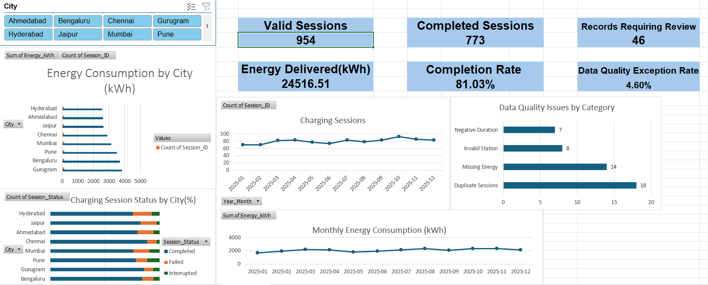
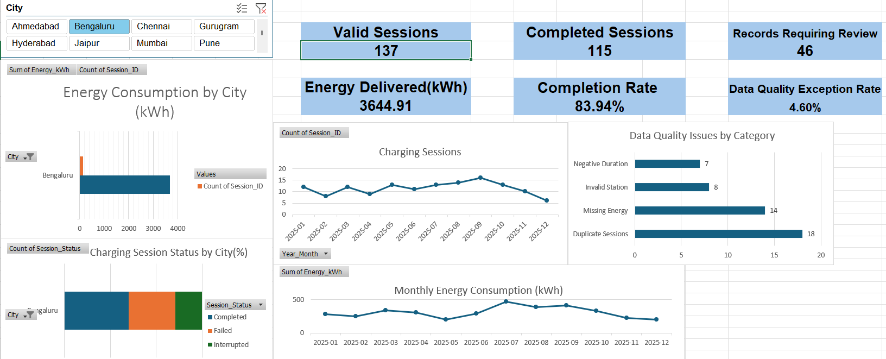
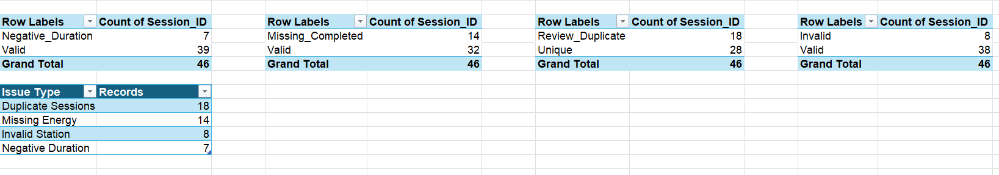
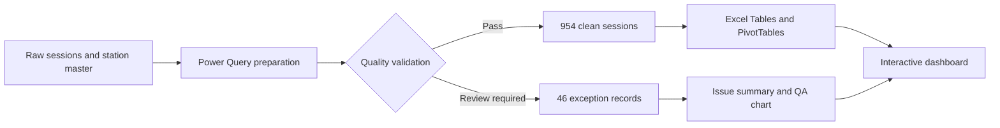

# VoltRoute | EV Charging Network Analytics

**An interactive Excel dashboard for EV charging reliability, usage trends, and data quality.**

Built using **Power Query, Excel Tables, PivotTables, PivotCharts, `COUNTIFS`/`SUMIFS`, `XLOOKUP`, and `GETPIVOTDATA`**. The project follows a complete analytical workflow: profiling raw records, investigating data-quality exceptions, preparing a validated analysis layer, computing operational KPIs, and translating results into practical recommendations.

> **Data disclosure:** VoltRoute is a **fictional EV charging business** and the dataset is **synthetic**. Results are for portfolio demonstration, not actual company performance.

<!-- Add your final dashboard screenshot after correcting and verifying the workbook. -->
<!--  -->

## Project at a glance

| Measure | Verified figure | Definition |
|---|---:|---|
| Raw charging-session records | **1,000** | Input session rows before quality filtering |
| Analysis-ready sessions | **954** | Rows labelled `Pass` |
| Records flagged for review | **46 (4.60%)** | Distinct rows labelled `Review_Required` |
| Completed / failed / interrupted | **773 / 117 / 64** | Status counts among 954 clean rows |
| Completion rate | **81.03%** | Completed ÷ clean session count |
| Energy delivered, completed sessions | **24,516.51 kWh** | Sum of `Energy_kWh` where status = Completed |
| Recorded energy, all valid statuses | **24,921.20 kWh** | Sum over all 954 clean rows |
| Mean duration, completed sessions | **85.15 minutes** | Mean `Duration_Minutes` where status = Completed; **requires the final workbook correction** |
| Coverage | **8 cities, 36 stations, 12 months** | January–December 2025 |

**Important:** The current uploaded draft workbook originally labelled **31.72** as average duration; that is actually **average completed-session energy in kWh**. Correct `KPI_Analysis!B7` before committing the final workbook. See [Pre-publish validation](docs/VALIDATION_CHECKLIST.md).

## Business questions

1. Which cities generate the most charging activity and recorded energy?
2. Where are completed-session rates relatively strong or weak?
3. How do session volumes and energy consumption change month to month?
4. What data-quality problems could distort reporting, and how many records need investigation?

## Dashboard features

- **Dynamic operational KPIs:** clean sessions, completed sessions, completed energy, and completion rate.
- **City slicer:** filters linked PivotTables, PivotCharts, and `GETPIVOTDATA`-driven KPI cards.
- **City comparison:** recorded energy and completed / failed / interrupted shares.
- **Monthly analysis:** session volumes, energy totals, month-over-month changes, and mean energy per session.
- **Data-quality monitoring:** exception count, exception rate, and overlapping issue categories.

### Screenshots

Final screenshots will be added after workbook corrections and layout cleanup:

## Dashboard Preview



### Interactive City Filtering


### Data Quality Analysis

## Key insights

- **Gurugram** has the highest **all-status recorded energy** among the eight cities: **3,848.79 kWh**.
- **Chennai** has the highest completion rate: **88.24%** (90 completed out of 102 clean sessions).
- **Hyderabad** has the lowest completion rate: **75.22%** (85 of 113); its failed-session share is **17.70%**. This is an investigation priority, **not proof of a root cause**.
- **October 2025** has the highest session volume (**92**). **November 2025** has the highest recorded monthly energy (**2,344.22 kWh**).
- **August 2025** has the highest mean recorded energy per valid session (**29.80 kWh**).
- The quality investigation isolates **46 distinct records**, while the individual error flags total **47 occurrences**, because one record has more than one identified issue.

Read the reasoning and operational next steps in [Business insights](docs/BUSINESS_INSIGHTS.md).

## Data workflow



**Quality checks** evaluate duplicate session IDs, missing energy for completed sessions, invalid station references, and negative durations. The two clean rows with missing energy on **non-completed** statuses are retained under the project's current validation policy; do not interpret those blanks as zero consumption. Details: [Methodology](docs/METHODOLOGY.md).

## Tools and techniques

| Tool / feature | Use in this project |
|---|---|
| Power Query | Transform status values, derive dates/durations, apply validation flags, split pass and review rows |
| Excel Tables | Structured references and expanding formula ranges |
| `XLOOKUP` | Resolve charging station ID to city through the station master |
| `COUNTIF` / `COUNTIFS` | Status counts and exception category counts |
| `SUMIFS` / `AVERAGEIFS` | Energy and completed-session metrics |
| PivotTables and PivotCharts | City and monthly aggregations |
| Slicer and `GETPIVOTDATA` | Interactive, city-specific KPI cards |
| `SUMIF` and MoM formulas | Align monthly measures and compute month-over-month changes |

Example calculations (table names are taken from the audited draft and should be checked after cleanup):

```excel
=COUNTIF(Clean_Sessions[Session_Status],"Completed")
=SUMIFS(Clean_Sessions[Energy_kWh],Clean_Sessions[Session_Status],"Completed")
=AVERAGEIFS(Clean_Sessions[Duration_Minutes],Clean_Sessions[Session_Status],"Completed")
=GETPIVOTDATA("Count of Session_ID",Pivot_Analysis!$A$3)
```

## Repository structure

```text
VoltRoute-EV-Charging-Analytics/
├── README.md
├── VoltRoute_EV_Charging_Analytics.xlsx    # Add corrected final workbook
├── assets/
│   └── screenshots/
│       ├── dashboard-overview.png           # Add after final review
│       ├── city-filter.png                  # Add after final review
│       └── data-quality.png                 # Add after final review
├── docs/
│   ├── DATA_DICTIONARY.md
│   ├── METHODOLOGY.md
│   ├── BUSINESS_INSIGHTS.md
│   ├── VALIDATION_CHECKLIST.md
│   ├── WORKBOOK_CLEANUP.md
│   ├── INTERVIEW_WALKTHROUGH.md
│   ├── PORTFOLIO_DESCRIPTIONS.md
│   └── GITHUB_PUBLISHING.md
├── RELEASE_NOTES.md
└── .gitignore
```

The included starter case study also contains a synthetic service-ticket table. **Ticket/SLA and revenue analytics are not part of this completed scope**; see [Future extensions](#future-extensions).

## Open the project

1. Download `VoltRoute_EV_Charging_Analytics.xlsx` after it has been uploaded to this repository.
2. Open it in **desktop Microsoft Excel** for full Power Query, PivotTable, slicer and `GETPIVOTDATA` functionality. The GitHub preview does **not** run the workbook interactively.
3. Open the `Dashboard` worksheet, clear the City slicer filter, and review the overall KPIs.
4. Select a city; verify the operational KPIs and linked charts respond.
5. Explore the `Data_Quality_Exceptions`, `DQ_Analysis`, and `Monthly_Analysis` worksheets for supporting calculations.

**Reproducibility note:** The workbook stores transformed tables and PivotTable caches. For live refresh, use **Data → Refresh All** in Excel desktop; first ensure all Power Query sources use available workbook tables or update any file paths. The final release must pass the [validation checklist](docs/VALIDATION_CHECKLIST.md).

## Assumptions and limitations

- **Synthetic data:** no real-world benchmark, regulatory claim, or operational impact is implied.
- **Excluded rows:** 46 review-required records are not used to calculate operational completion or energy KPIs. Flags can overlap.
- **Energy definitions differ:** **24,516.51 kWh** applies to completed sessions only; **24,921.20 kWh** includes all quality-passing statuses, including interrupted charging energy.
- **Ratings completeness:** 150 of 954 clean-session records have no customer rating. Any future rating average needs a clearly labelled available-response denominator.
- **Exploratory comparisons:** the dataset alone does not establish why a city has a higher failure rate, and no statistical significance test has been run.
- **Out of scope:** customer-level behavioural inference, revenue forecasting, charger uptime validation, and service-ticket/SLA conclusions.

## Future extensions

- Add ticket-to-session mapping and resolution-time/SLA KPIs.
- Model gross charging revenue from price and delivered energy with stated payment/discount assumptions.
- Add station-level exception rates and repeat-failure diagnostics.
- Introduce validation tests and an automated refresh/reconciliation report.
- Rebuild the cleaned model in SQL and/or Power BI for a multi-tool portfolio demonstration.

## Documentation

[Methodology](docs/METHODOLOGY.md) · [Data dictionary](docs/DATA_DICTIONARY.md) · [Business insights](docs/BUSINESS_INSIGHTS.md) · [Validation checklist](docs/VALIDATION_CHECKLIST.md) · [Interview walkthrough](docs/INTERVIEW_WALKTHROUGH.md) · [CV & LinkedIn descriptions](docs/PORTFOLIO_DESCRIPTIONS.md) · [Publishing steps](docs/GITHUB_PUBLISHING.md)

---

**Portfolio project:** [TanishKalra99 on GitHub](https://github.com/TanishKalra99)  
**Source context:** Synthetic practice case supplied in the workbook's `START_HERE` sheet.  
**License:** No reuse license is granted by this repository until a suitable license and source-data permission are confirmed.
